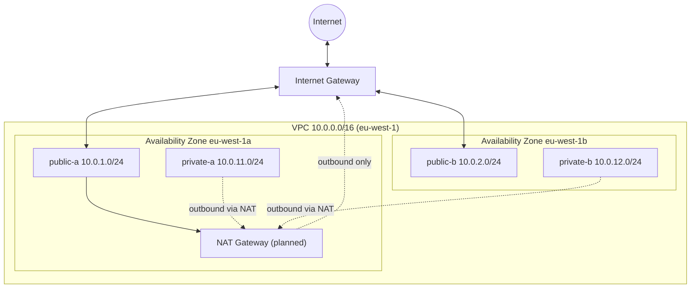

# Architecture

This document describes the network layout of the dev environment and how traffic flows through it.

## Network diagram

## Traffic flow

- **Inbound from users:** Internet → Internet Gateway → public subnets. The load balancer (Day 3) lives here.
- **Outbound from private subnets:** private subnet → route table → NAT gateway → Internet Gateway → Internet. Nothing from the internet can initiate a connection into a private subnet.
- **Database and app servers:** private subnets only, never reachable directly from the internet.

## Security boundaries

| Boundary | Enforced by |
|---|---|
| Internet to VPC | Internet Gateway, attached only to the VPC |
| Public to private | Route tables: private subnets have no route to the IGW |
| Instance to instance | Security groups (Day 3) |
| Default security group | Adopted by Terraform with no rules |

## Current state

- Built and verified with `terraform plan`: 17 resources.
- Applied and destroyed once to confirm the design works and to control cost.
- The NAT gateway is created only when needed (see ADR-001).

## Related decisions

- [ADR-001: NAT gateway](decisions/ADR-001-nat-gateway.md)
- [ADR-002: state backend](decisions/ADR-002-state-backend.md)
